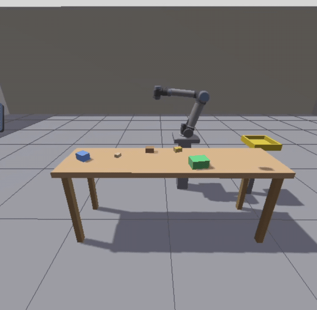
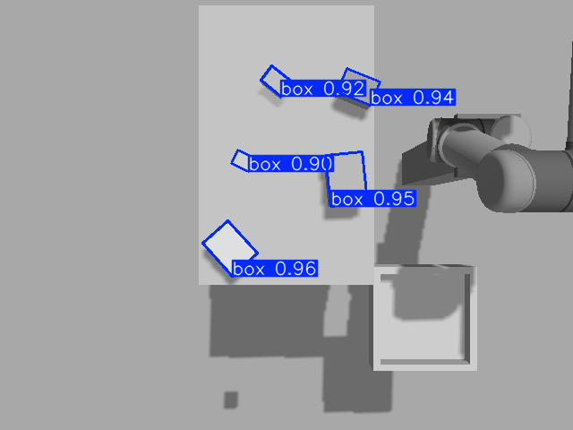
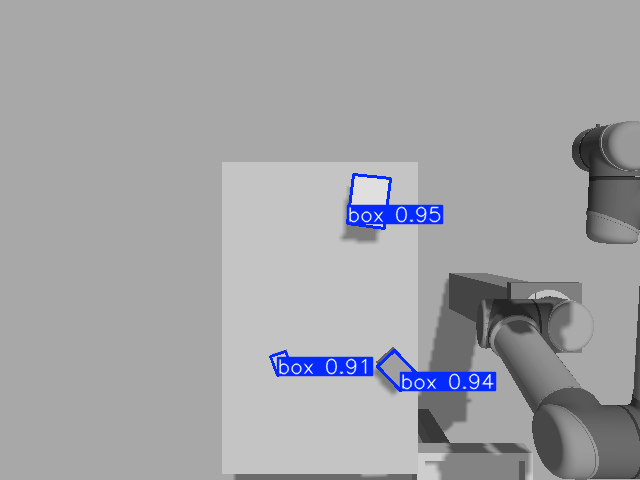
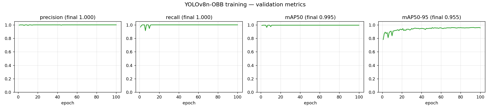
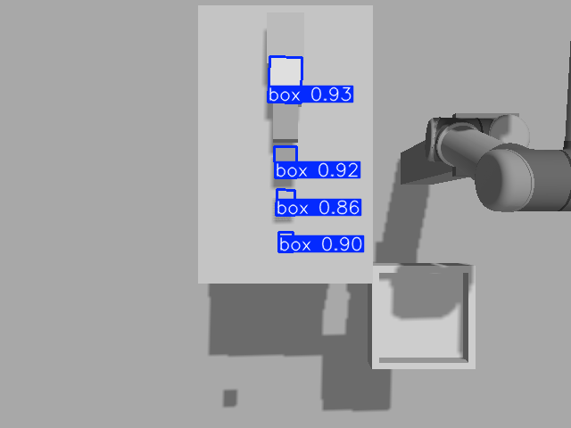
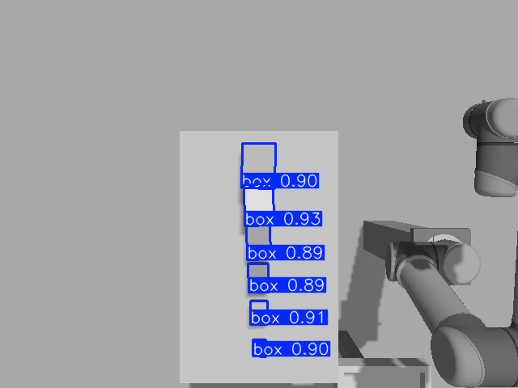
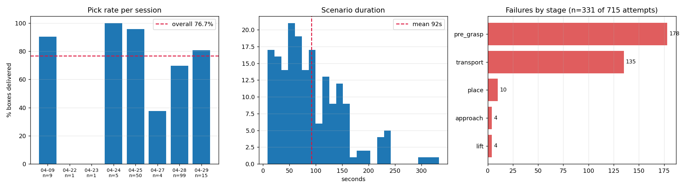

# Vision-Guided Grasping

Autonomous pick & place with a **UR5 on a linear rail**, driven by a **stereo camera pair**:
YOLOv8-OBB finds the boxes, stereo disparity recovers their 3D pose, MoveIt 2 plans and executes
the grasp. Everything runs locally in Gazebo Harmonic — no depth sensor, no cloud inference.

<p align="center">
  <br>
  <sub>Full run, 13× speed: the arm clears the table box by box, repositioning along the rail
  between picks. Source clip: <a href="docs/pick_place_demo.mp4">docs/pick_place_demo.mp4</a></sub>
</p>

<p align="center">
  
  <br>
  <sub>YOLOv8-OBB detections from the left and right overhead cameras</sub>
</p>

## Pipeline

```
/camera_left/image_raw  ─┐
                         ├─► yolo_detector ─► /detections/boxes_{left,right}
/camera_right/image_raw ─┘    (YOLOv8-OBB)      oriented box: centre, size, angle
                                   │
                                   ▼
                            pose_estimator  ─► /grasp_pose   (X, Y, Z, yaw in world frame)
                            stereo disparity + back-projection
                                   │
                                   ▼
                            pick_place_node ─► MoveIt 2 (MoveGroup) ─► UR5 + slider
                            10-step cycle, rail repositioning between picks
```

## Stereo pose estimation

Two overhead cameras, baseline **B = 0.60 m**, mounted at **z = 2.50 m** above a table at 0.78 m.
Intrinsics `fx = fy = 380`, `cx = 320`, `cy = 240` (640×480, HFOV 80°).

Both cameras are yawed by π/2, so disparity is measured along the **u** axis:

```
Δu    = u_L − u_R
z_top = z_cam − B · fx / |Δu|                 # height of the box top surface

X = cam_x + sign_x · (u − cx) / fx · (z_cam − z_top)
Y = cam_y + sign_y · (v − cy) / fy · (z_cam − z_top)
yaw = θ_OBB                                   # straight from the oriented box
```

Depth comes from the stereo pair rather than from an RGB-D sensor, which keeps the scene
sensor-agnostic and makes the estimate independent of object size priors.

## Moving base

The UR5 is mounted on a prismatic joint (`slider_joint`, ±0.70 m) driven by a
`JointGroupPositionController` through `ros2_control`. This extends the reachable span along X
from 0.85 m to 2.25 m — a factor of 2.6 — so a single arm covers the whole table, and the rail is
repositioned between picks as part of the cycle.

## Detector

**Dataset** — 501 annotated stereo frames (242 left + 259 right), split 351 / 75 / 75 (seed 42),
converted to 3-channel grayscale. Stored in `experiments/dataset_stereo_final/`.

**Training** — YOLOv8n-OBB, 100 epochs on a Colab T4 (~40 min), with mosaic 1.0, mixup 0.1,
copy-paste 0.3, ±15° rotation, flips and HSV-value jitter. Notebook: `train_yolo_colab.ipynb`.

**Validation metrics**, final epoch of `experiments/runs/stereo_v1/results.csv`:

| Precision | Recall | mAP50 | mAP50-95 |
|---|---|---|---|
| 1.000 | 1.000 | 0.995 | 0.955 (best 0.961) |

<p align="center"></p>

**A caveat worth stating plainly:** precision and recall saturate at 1.0 within ten epochs. That is
not a strong result — it means the synthetic task is too easy. The boxes are untextured primitives
under fixed lighting, never occluding one another, always viewed from the same height. A detector
that is perfect here says very little about a detector on real pallets, and the honest next step is
harder data (clutter, occlusion, varied lighting, real imagery) rather than a bigger model.

## Why two cameras: the line test

The case that justifies the stereo pair is boxes arranged in a single line along the optical axis.
From one viewpoint the near boxes occlude the far ones; from the other they do not.

<p align="center">
  
  
</p>

**Left camera: 4 of 6 boxes. Right camera: 6 of 6.** Same model, same frame, same instant — only
the viewpoint differs. A mono pipeline silently loses a third of the objects in this configuration;
the stereo pair recovers all of them.

## Experiment

**184 scenarios, 715 individual grasp attempts**, logged between 9 and 29 April 2026 with
positional noise σ = 0.015 m injected into every grasp pose. Raw logs:
`experiments/scenarios.csv` (per scenario) and `experiments/metrics.csv` (per attempt).

| Metric | Value |
|---|---|
| Pick rate, all 184 scenarios | **76.7 %** (478 of 623 boxes delivered) |
| Pick rate, best session (n = 50) | 95.8 % |
| Scenarios completed with no failed attempt | 31.5 % |
| Mean scenario duration | 92 s (range 12–330 s) |
| Attempts that failed | 331 of 715 |

<p align="center"></p>

The spread between sessions is the interesting part. Configuration changed over the run — approach
height, tray position, soft-fail handling — and pick rate moves between 37.5 % and 100 % as a
result. The 76.7 % figure pools every configuration, including the ones that were later abandoned;
the best tuned configuration reaches 95.8 % over 50 scenarios. Both numbers are reported because
only the pair of them describes the system honestly.

**Failures by stage:** `pre_grasp` 178, `transport` 135, `place` 10, `approach` 4, `lift` 4.

Two dominant modes, with different causes. `pre_grasp` failures are planning failures — the arm
cannot reach the commanded pre-grasp pose, typically near the edge of the workspace even with the
rail. `transport` failures are the attachment model letting go mid-carry: Gazebo does not simulate
grasp friction, so `gz_attach_node` fixes the box to the gripper by TF, and that fixture breaks
under fast trajectories. The second mode is an artefact of simulating a grasp rather than a
property of the method.

## Limitations

- **Grasping is virtual.** No friction, no contact dynamics, no gripper force. `gz_attach_node`
  attaches the nearest box by TF and carries it. Nothing here transfers to a real gripper unchanged.
- **No baseline comparison.** A mono-camera variant exists in the repository history but was never
  run through the same 184-scenario protocol, so there is no controlled measurement of what stereo
  buys beyond the line test above.
- **Synthetic data only.** The detector has never seen a real camera frame.
- **Single object class.** Rectangular boxes, primitive shapes, no textures.

## Running it

Requires Docker. Everything runs inside the container; the Gazebo GUI is served over noVNC.

```bash
docker build -t gazebo-ros2-moveit -f docker/Dockerfile.ros2gz docker/
./run_ros2.sh
docker exec ros2-gazebo bash -c "source /opt/ros/jazzy/setup.bash && cd /ros2_ws && colcon build"
./run_ros2.sh
```

Wait ~25 s, then open <http://localhost:8082/vnc.html>.

```bash
# cycle status
docker exec ros2-gazebo bash -c "source /opt/ros/jazzy/setup.bash && ros2 topic echo /pick_place/status"
# logs
docker exec ros2-gazebo tail -f /tmp/sim.log
```

Reproduce the experiment and the plots:

```bash
python experiments/run_experiment.py      # writes scenarios.csv / metrics.csv
python experiments/analyze_metrics.py     # writes experiments/plots/
```

## Layout

```
ros2_ws/src/
├── pick_place_bringup/
│   ├── launch/sim.launch.py        # Gazebo, UR5 + rail, controllers, bridge, cameras, nodes
│   ├── scripts/                    # yolo_detector, pose_estimator, pick_place_node,
│   │                               #   gz_attach_node, camera_info_pub
│   ├── config/                     # camera intrinsics, detector, pose estimator, controllers
│   └── urdf/ur5_gz.urdf.xacro      # UR5 + RG2 gripper on a prismatic slider
└── pick_place_msgs/msg/            # BoxDetection, BoxDetectionArray
worlds/                             # Gazebo scene (table, tray, 6 boxes, stereo rig), models
experiments/                        # dataset, training logs, experiment scripts, raw CSV logs, plots
docker/                             # ROS 2 Jazzy + Gazebo Harmonic + MoveIt 2 + Ultralytics
```

**Stack:** ROS 2 Jazzy · Gazebo Harmonic · MoveIt 2 · ros2_control · UR5 · YOLOv8-OBB · PyTorch ·
OpenCV · Docker
