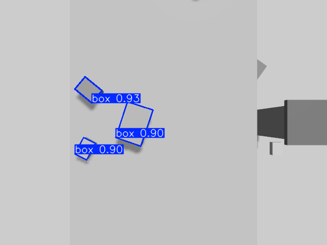
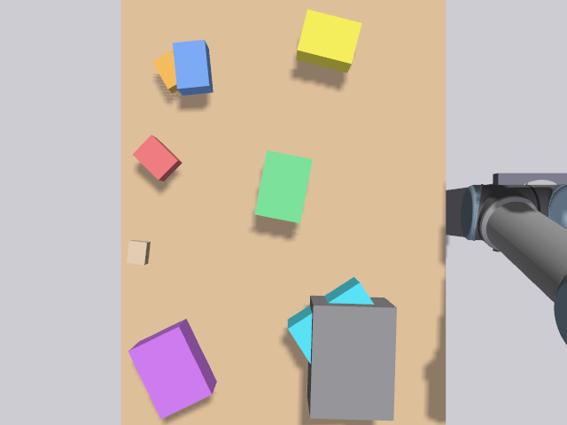

# Vision-Guided Grasping

Автономный захват объектов манипулятором UR5 по данным одной RGB-камеры: детекция YOLOv8-OBB, оценка 3D-позы без depth-сенсора, планирование траекторий в MoveIt 2 и pick & place в симуляции Gazebo Harmonic.

<p align="center">
  
  
</p>

## Как это работает

```
overhead camera ──► yolo_detector ──► pose_estimator ──► pick_place_node ──► MoveIt 2 ──► UR5
  /camera/image_raw   /detections/boxes   /grasp_pose        MoveGroup action
                      (OBB: центр,        (x, y, z, yaw       8 этапов: pre-grasp → approach →
                       размеры, угол)      в мировой СК)       attach → lift → transport →
                                                               place → detach → retreat
```

1. **Детекция.** `yolo_detector` получает кадр с камеры над столом и находит объекты моделью YOLOv8-OBB. Для каждого объекта публикуется ориентированный bounding box: центр, размеры и угол поворота (`pick_place_msgs/BoxDetectionArray`). Если загружена обычная модель без OBB, угол оценивается через `cv2.minAreaRect`.
2. **Оценка 3D-позы без depth-сенсора.** `pose_estimator` переводит 2D-детекцию в позу захвата по модели pinhole-камеры: обратная проекция центра на плоскость стола, оценка высоты объекта по размеру его проекции, уточнение глубины и расчёт yaw по углу OBB.
3. **Планирование и захват.** `pick_place_node` преобразует позу в систему координат MoveIt 2, строит ориентацию схвата «сверху вниз» с учётом yaw объекта и выполняет цикл из 8 этапов через action `MoveGroup`. Объекты раскладываются в лоток по сетке 2×3, стол добавлен в сцену как collision object.
4. **Удержание объекта.** В Gazebo нет надёжной физики захвата, поэтому `gz_attach_node` по сервисам `/attach_object` и `/detach_object` привязывает ближайший объект к схвату и сопровождает его во время переноса.

## Детектор: синтетический датасет и обучение

- **Автоматический сбор и разметка данных из симуляции** (`tools/collect_dataset.py`): скрипт случайно расставляет объекты на столе без пересечений, снимает кадр и строит OBB-разметку из истинных поз объектов в Gazebo. Ручная разметка не нужна. В репозитории лежит собранный датасет: 423 изображения train и 112 val.
- **Аугментации для переноса sim-to-real** (`tools/augment_dataset.py`, albumentations): яркость и контраст, шум сенсора, motion blur, поворот ±5°, сдвиг HSV. Углы OBB трансформируются вместе с изображением, валидация не аугментируется.
- **Дообучение YOLOv8n-OBB**: `tools/train_yolo.py` (Colab / GPU) и `tools/train_local.py` (macOS, MPS).

## Стек

ROS 2 Jazzy · Gazebo Harmonic · MoveIt 2 · ros2_control · UR5 · YOLOv8-OBB (Ultralytics) · PyTorch · OpenCV · albumentations · Docker · noVNC

## Структура

```
├── docker/
│   ├── Dockerfile.ros2gz          # Ubuntu 24.04 + ROS 2 Jazzy + Gazebo Harmonic + MoveIt 2 + Ultralytics
│   └── start_ros2gz.sh            # виртуальный дисплей и noVNC внутри контейнера
├── ros2_ws/src/
│   ├── pick_place_bringup/
│   │   ├── launch/sim.launch.py   # Gazebo, UR5, контроллеры, мост ROS–Gazebo, камера, все узлы
│   │   ├── scripts/               # yolo_detector, pose_estimator, pick_place_node, gz_attach_node, camera_info_pub
│   │   ├── config/                # параметры камеры, детектора, оценки позы, MoveIt 2, контроллеров
│   │   ├── tools/                 # сбор датасета, аугментации, обучение YOLO
│   │   └── urdf/ur5_gz.urdf.xacro
│   └── pick_place_msgs/msg/       # BoxDetection, BoxDetectionArray
├── worlds/                        # миры Gazebo, модели, датасет
└── run_ros2.sh                    # полный запуск симуляции
```

## Запуск

Нужен Docker. Всё работает в контейнере, GUI открывается в браузере через noVNC.

```bash
# 1. Собрать образ (один раз)
docker build -t gazebo-ros2-moveit -f docker/Dockerfile.ros2gz docker/

# 2. Запустить контейнер и собрать ROS 2 workspace (один раз)
./run_ros2.sh
docker exec ros2-gazebo bash -c "source /opt/ros/jazzy/setup.bash && cd /ros2_ws && colcon build"

# 3. Запустить симуляцию
./run_ros2.sh
```

После запуска подождите около 25 секунд и откройте http://localhost:8082/vnc.html.

Логи: `docker exec ros2-gazebo tail -f /tmp/sim.log`
Статус цикла захвата: `docker exec ros2-gazebo bash -c "source /opt/ros/jazzy/setup.bash && ros2 topic echo /pick_place/status"`

Обученная модель детектора лежит в `worlds/models/yolo_boxes.pt` (путь задаётся в `config/yolo_params.yaml`). Переобучить её можно скриптами из `tools/` на датасете из `worlds/dataset_fixed/`.
